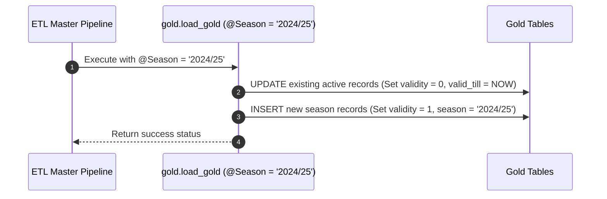

# 🏛️ Architecture & System Design

This document details the architectural blueprint, data modeling paradigms, and technical decision records of the **Football Manager Data Warehouse & Moneyball Analytics Engine** (`DW`).

---

## 1. Overview & Architectural Philosophy

The architecture of `DW` adapts modern cloud data engineering best practices—specifically the **Medallion Architecture** and **Kimball Dimensional Modeling**—for sports analytics and tactical decision support.

### Core Objectives
1. **Separation of Concerns:** Distinct separation between raw ingestion (Bronze), clean conformant data (Silver), and dimensional star-schema modeling with analytical marts (Gold).
2. **Multi-Season Time Travel:** Preserving historical player performance across career progressions using **Slowly Changing Dimensions (SCD Type 2)**.
3. **Club & Save Portability:** Complete decoupling from hardcoded club names (e.g. `'Fiorentina'`) using dynamic squad flagging (`is_own_squad`) and league normalization coefficients.
4. **Resilience & Data Integrity:** Automated unit testing, dbt-style integrity assertions, null-safe mathematical algorithms, and structured batch audit logging.

```mermaid
flowchart TD
    subgraph Ingestion ["Raw Landing"]
        R1[FM24 CSV Exports]
    end

    subgraph Bronze ["🥉 Bronze Layer (Raw Storage)"]
        B1[(bronze.fmdata_team_players)]
        B2[(bronze.fmdata_team_gks)]
        B3[(bronze.fmdata_interested_out_players)]
        B4[(bronze.fmdata_interested_gks)]
    end

    subgraph Silver ["🥈 Silver Layer (Cleansed & Enriched)"]
        S1[(silver.fmdata_team_players)]
        S2[(silver.fmdata_team_gks)]
        S3[(silver.fmdata_interested_out_players)]
        S4[(silver.fmdata_interested_gks)]
    end

    subgraph Gold ["🥇 Gold Layer (Star Schema & SCD Type 2)"]
        D1[(dim_player_info)]
        D2[(dim_team_info)]
        D3[(dim_club)]
        D4[(dim_league)]
        F1[(fact_outfield_player_stats)]
        F2[(fact_gk_stats)]
        F3[(fact_players_value)]
    end

    subgraph Analytics ["📊 Analytics & Decision Layer"]
        M1[Wide Scouting Marts]
        M2[8x Positional Similarity Engines]
        M3[Tactical Archetype Classifier]
        M4[Squad Succession & Bargain Watch]
        M5[Player Growth Tracking]
    end

    R1 -->|BULK INSERT| Bronze
    Bronze -->|silver.load_silver| Silver
    Silver -->|gold.load_gold @Season| Gold
    Gold --> Analytics
```



---

## 2. Medallion Layer Specifications

### 🥉 Bronze Layer: Landing Zone
* **Objective:** Ingest raw CSV data exported directly from Football Manager 24 with minimal friction and zero data loss.
* **Storage Philosophy:** Wide tables with loose typing (`NVARCHAR(MAX)` or large `VARCHAR`), matching the raw columns of FM24 view exports.
* **Ingestion Method:** T-SQL `BULK INSERT` using UTF-8 code page (`CODEPAGE = '65001'`), comma-delimited, tab-locked for performance.
* **Dynamic Multi-Partition Ingestion:** Transparently discovers and loads any number of split scouting exports (`interested_out_players1.csv` ... `interested_out_players8.csv`+ or single `interested_out_players.csv`) into a single unified table `bronze.fmdata_interested_out_players` without requiring extra lines of DDL or code changes.
* **Idempotency:** Truncate-and-load pattern managed by `bronze.load_bronze` with decoupled `@DataPath` parameter.

### 🥈 Silver Layer: Cleansing, Normalization & Typing
* **Objective:** Clean, parse, validate, and standardize data into structured tabular representations.
* **Key Transformations:**
  1. **String Sanitization:** Removing UI artifact strings (e.g. replacing `' - Pick Player'` in names, trimming whitespace).
  2. **Null & Dash Handling:** FM24 exports empty or zero values as `'-'`. Silver converts these conditionally to `0` or `NULL`.
  3. **Percentage Parsing:** Converts string percentages (e.g. `'78%'`) to decimal proportions (`0.78` as `DECIMAL(5, 2)`).
  4. **Financial Formatting:** Parses currency strings (e.g. `'£1.2M'`, `'£45K'`, `'£25,000 p/w'`) into numeric millions (`DECIMAL(10, 2)`) and thousands (`DECIMAL(10, 2)`).
  5. **Positional Standardization:** Standardizes abbreviated FM tactical positions (e.g. `'ST (C)'` $\to$ `'Striker'`, `'D (C)'` $\to$ `'Central Defender'`, `'WB (R)'` $\to$ `'Right Wingback'`).
* **Contracted vs. Scouting Flagging:**
  * External scouting files (`interested_out_players.csv`) often contain players currently contracted to the user's club. Silver enforces filtering (`WHERE contracted = 1` vs `contracted = 0`) to prevent duplicate entity representation.

### 🥇 Gold Layer: Star Schema & Dimensional Modeling
* **Objective:** Present optimized dimensional models (Facts and Dimensions) structured for analytical aggregation, machine learning similarity comparisons, and reporting.
* **Modeling Methodology:** Kimball Star Schema with surrogate keys (`player_key`, `team_key`, `club_key`, `league_key`).
* **Grain:**
  * Outfield Stats: One row per player per team per season (`player_key`, `team_key`, `season`).
  * Goalkeeper Stats: One row per goalkeeper per team per season (`player_key`, `team_key`, `season`).
  * Player Valuation: One row per player per team per season (`player_key`, `team_key`, `season`).

---

## 3. Slowly Changing Dimensions (SCD Type 2) & Multi-Season Historization

In Football Manager, player abilities, physical attributes, market valuations, and tactical metrics fluctuate dramatically over multiple seasons. Overwriting records prevents analysts from evaluating development curves or past transfer effectiveness.

`DW` implements **SCD Type 2** across the Gold layer:

### Tracking Columns
Every dimension and fact table in the Gold layer maintains temporal lineage:
* `season VARCHAR(9)`: The active in-game competitive season (e.g. `'2023/24'`, `'2024/25'`).
* `dwh_create_date DATETIME2`: Timestamp when the record became active in the warehouse.
* `dwh_cd_valid_till DATETIME2`: Expiration timestamp (set to `'9999-12-31 23:59:59.9999999'` for currently active records).
* `dwh_current_validity BIT`: `1` if currently active; `0` if superseded by a newer season snapshot.

### Loading Logic (`gold.load_gold @Season`)
When a new season's data is loaded:
1. **Retire Prior Active Records:** Existing records matching the entity keys have their `dwh_cd_valid_till` updated to `GETDATE()` and `dwh_current_validity` flipped to `0`.
2. **Insert Active Snapshot:** New records are inserted with `dwh_current_validity = 1`, `dwh_cd_valid_till = '9999-12-31'`, and `season = @Season`.



---

## 4. Star Schema Architecture & Entities

### Dimension Tables

| Dimension | Primary Key | Natural Key | Grain | Description |
| :--- | :--- | :--- | :--- | :--- |
| **`gold.dim_player_info`** | `player_key` (Surrogate) | `player_id` | Player per Season | Player profile, age, primary position, squad ownership (`is_own_squad`), contract status, and SCD2 validity. |
| **`gold.dim_team_info`** | `team_key` (Surrogate) | `club_name` + `league` | Team per Season | Club name, competitive league, and temporal validity. |
| **`gold.dim_club`** | `club_key` (Surrogate) | `club` | Club Entity | Distinct football club registry. |
| **`gold.dim_league`** | `league_key` (Surrogate) | `league` | League Entity | League registry and `league_difficulty_coef` multiplier. |

### Fact Tables

| Fact Table | Foreign Keys | Grain | Description |
| :--- | :--- | :--- | :--- |
| **`gold.fact_outfield_player_stats`** | `player_key`, `team_key` | Player per Team per Season | Core per-90 outfield performance metrics (shooting, passing, defending, athletic volume, creation). |
| **`gold.fact_gk_stats`** | `player_key`, `team_key` | Goalkeeper per Team per Season | Goalkeeping performance (shot stopping, expected save %, sweep actions, parries/holds, distribution). |
| **`gold.fact_players_value`** | `player_key`, `team_key` | Player per Team per Season | Financial metrics (weekly wage in £k, estimated transfer market valuation in £M). |

---

## 5. Architectural Decision Records (ADRs)

### ADR-01: Deprecation & Removal of OCR Team Possession Data
* **Context:** Early iterations experimented with scraping team possession percentages from screenshot PNGs using Python EasyOCR and storing them in `fact_teams_possession` to calculate possession-adjusted defensive metrics (PAdj tackles/interceptions).
* **Problem:** Taking screenshots across multiple playable leagues was labor-intensive, error-prone, and required external Python OCR dependencies, breaking pure SQL reproducibility across different saves.
* **Decision:** Decoupled and dropped all references to `fact_teams_possession` in the Gold and Silver pipelines. Defensive metrics transitioned to **unweighted volume metrics** (tackles won, interceptions, clearances, blocks) alongside efficiency ratios (tackle accuracy %, reactive vs. positional defending share).
* **Consequence:** 100% self-contained data pipeline requiring only standard Football Manager view exports. Zero screenshot friction.

### ADR-02: Portability & Club-Agnostic Design
* **Context:** Initial scripts contained hardcoded strings such as `'Fiorentina'` in stored procedures and views.
* **Problem:** Users managing other clubs (e.g. Arsenal, Dortmund, Ajax) could not utilize the platform without search-and-replacing SQL files.
* **Decision:** Replaced all hardcoded club strings with an **`is_own_squad` bit flag**. Any player exported from the user's squad (`team_players.csv`) receives `is_own_squad = 1`, while scouted players receive `is_own_squad = 0`.
* **Consequence:** The entire warehouse operates dynamically for any user club in any league.

### ADR-03: Null-Safety via Tactical Baseline Imputation
* **Context:** In Microsoft SQL Server, if any component of an arithmetic expression evaluates to `NULL`, the entire expression returns `NULL`. In Euclidean distance calculations $\sqrt{\sum w_i (A_i - B_i)^2}$, a single missing stat (e.g. player with 0 shots or 0 crosses) caused the entire similarity distance to become `NULL`, dropping valid scout targets.
* **Decision:** Wrapped all metric variables in `COALESCE` with neutral, positional tactical baselines (e.g. `0.40` for shot on target %, `0.75` for tackle accuracy %, `0.10` for conversion rate).
* **Consequence:** Zero targets are dropped due to arithmetic null propagation.

### ADR-04: Declarative View Layer for Analytics vs. Physical Marts
* **Context:** Analytical metrics (such as Euclidean similarity rankings, tactical archetypes, and percentile ranks) could either be stored as physical tables updated via stored procedures or as declarative SQL views.
* **Decision:** Maintained analytical marts and similarity engines as **declarative SQL Views** (`gold.views-gold.sql`), while persisting historical snapshots in Gold fact/dimension tables.
* **Consequence:** Similarity rankings and percentiles compute dynamically on-demand with zero pipeline staleness when scouting criteria or weights are adjusted.

---

## 6. Observability & Audit Framework

Pipeline executions are recorded in the dedicated `audit.etl_pipeline_log` table:

```sql
CREATE TABLE audit.etl_pipeline_log (
    log_id INT IDENTITY(1,1) PRIMARY KEY,
    batch_id UNIQUEIDENTIFIER DEFAULT NEWID(),
    pipeline_layer VARCHAR(20) NOT NULL, -- 'Bronze', 'Silver', 'Gold', 'Complete'
    step_name VARCHAR(100) NOT NULL,
    status VARCHAR(20) NOT NULL,        -- 'Started', 'Success', 'Failed'
    rows_affected INT DEFAULT 0,
    start_time DATETIME2 DEFAULT GETDATE(),
    end_time DATETIME2 NULL,
    duration_ms INT NULL,
    error_message NVARCHAR(4000) NULL
);
```

Every execution of `dbo.usp_run_warehouse_pipeline` generates a unique `batch_id`, logging start timestamps, millisecond durations, execution status, and precise SQL error messages via `CATCH` blocks.
