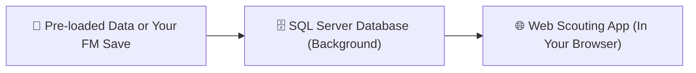

# 🔰 Zero-Coding Setup Guide: Football Manager Analytics Engine

> **Welcome, Manager!**  
> If you love Football Manager 24, Moneyball scouting, and deep data analytics, but have **little to no coding or database experience**, this guide is written specifically for you.

You do **not** need to be a software engineer, data scientist, or database administrator to run this warehouse or explore your players in the web app.

---

## 🧭 Table of Contents
1. [What This Project Is (In Plain English)](#1-what-this-project-is-in-plain-english)
2. [What You Need Before Starting](#2-what-you-need-before-starting)
3. [Choose Your Operating System](#3-choose-your-operating-system)
   - [🪟 Microsoft Windows (10 & 11)](#-microsoft-windows-10--11)
     - [Option A: 1-Click with Docker Desktop (Recommended)](#option-a-1-click-with-docker-desktop-recommended)
     - [Option B: Native SQL Server & SSMS (No Docker)](#option-b-native-sql-server--ssms-no-docker)
   - [🍏 Apple macOS (M1/M2/M3/M4 Apple Silicon & Intel)](#-apple-macos-m1m2m3m4-apple-silicon--intel)
   - [🐧 Linux (Ubuntu, Debian, Fedora, Arch, Pop!_OS)](#-linux-ubuntu-debian-fedora-arch-pop_os)
4. [Launching the Interactive Web Scouting App](#4-launching-the-interactive-web-scouting-app)
5. [Using Your Own FM24 Save Data](#5-using-your-own-fm24-save-data)
6. [Daily Usage: Starting and Stopping](#6-daily-usage-starting-and-stopping)
7. [Troubleshooting & FAQs for Non-Coders](#7-troubleshooting--faqs-for-non-coders)

---

## 1. What This Project Is (In Plain English)

This project has three main pieces:
1. **The Database (Microsoft SQL Server):** Runs silently in the background. It stores match statistics, calculates per-90 metrics, and runs the Moneyball similarity math (finding statistical twins for any player).
2. **The Data:** Comes pre-packaged with **over 11,350 scouted players** and a complete sample squad! You can test and browse the entire platform right away without exporting anything from FM.
3. **The Web App:** An interactive website that opens in your browser (`http://localhost:3000`). It gives you **FBref scouting reports**, **Opta / StatsBomb pizza charts**, and a **TradingView-style player screener**.



---

## 2. Software Directory & Download Links

Here is the complete list of software tools you may need or encounter. Depending on your workflow, some are **essential** (needed to run the database and website) while others are **optional** (for viewing raw tables or creating offline charts).

### 🟢 2.1. Essential Software (To Run the Database & Web App)

| Software | Supported OS | What It Does (Plain English) | Where to Download |
| :--- | :--- | :--- | :--- |
| **Docker Desktop** | 🪟 Windows<br>🍏 macOS<br>🐧 Linux | **Runs the Database:** Launches Microsoft SQL Server 2022 inside a clean, isolated virtual container without installing heavy server components directly on your operating system. | **[Download Docker Desktop](https://www.docker.com/products/docker-desktop/)** |
| **Node.js (LTS)** | 🪟 Windows<br>🍏 macOS<br>🐧 Linux | **Runs the Web App:** Powers the Next.js scouting interface so you can search players, view FBref pizza charts, and use the TradingView screener in your browser. | **[Download Node.js LTS](https://nodejs.org/)** *(Choose LTS)* |
| **WSL 2** *(Windows only)* | 🪟 Windows | **Windows Subsystem for Linux:** Required by Docker Desktop on Windows. Usually installed automatically by Docker Desktop, or by opening PowerShell and typing `wsl --install`. | **[WSL 2 Microsoft Guide](https://learn.microsoft.com/en-us/windows/wsl/install)** |
| **Rosetta 2** *(Mac Apple Silicon)* | 🍏 macOS (M1/M2/M3/M4) | **Apple Silicon Translation:** Allows your Mac to run x86-based Docker containers (like SQL Server) at full native speed. Installed by typing `softwareupdate --install-rosetta` in Terminal. | Built into macOS |

---

### 🟡 2.2. Alternative for Windows (No Docker Approach)

If your PC cannot run Docker Desktop or you prefer installing Microsoft SQL Server natively:

| Software | Supported OS | What It Does | Where to Download |
| :--- | :--- | :--- | :--- |
| **Microsoft SQL Server 2022** *(Developer Edition)* | 🪟 Windows only | **Native Database Engine:** The official Microsoft database server installed directly on Windows (free for personal/development use). | **[Download SQL Server 2022](https://www.microsoft.com/en-us/sql-server/sql-server-downloads)** |
| **SQL Server Management Studio (SSMS)** | 🪟 Windows only | **Database Control Center:** The official Windows application to connect to SQL Server, execute SQL scripts, and inspect tables. | **[Download SSMS](https://aka.ms/ssmsfullsetup)** |

---

### 🔵 2.3. Optional Visual Database Browsers (View Data Like Excel)

You **do not** need a database viewer if you are using the web app (`http://localhost:3000`). However, if you want to inspect the raw database tables, views, and numbers like a giant spreadsheet:

| Software | Supported OS | What It Does | Where to Download |
| :--- | :--- | :--- | :--- |
| **Azure Data Studio** | 🪟 Windows<br>🍏 macOS<br>🐧 Linux | **Modern Lightweight SQL GUI:** Free cross-platform database viewer by Microsoft. Perfect for Mac and Linux users to view tables and run queries. | **[Download Azure Data Studio](https://azure.microsoft.com/en-us/products/data-studio/)** |
| **DBeaver Community** | 🪟 Windows<br>🍏 macOS<br>🐧 Linux | **Universal Database Tool:** Free, open-source tool for querying and browsing SQL databases with an intuitive grid interface. | **[Download DBeaver](https://dbeaver.io/download/)** |

---

### 🟣 2.4. Optional Utilities (For Offline Analytics & Easy Updates)

| Software | Supported OS | What It Does | Where to Download |
| :--- | :--- | :--- | :--- |
| **Python 3.9+** | 🪟 Windows<br>🍏 macOS<br>🐧 Linux | **Offline Chart Generator:** Only needed if you want to run the standalone CLI script (`scouting_dashboard.py`) to generate radar chart PNGs and scatter plots without the web app. | **[Download Python](https://www.python.org/downloads/)** |
| **GitHub Desktop** | 🪟 Windows<br>🍏 macOS | **Visual Code Downloader:** An easy point-and-click desktop app to download this repository and receive future updates with one click, without typing Git commands. | **[Download GitHub Desktop](https://desktop.github.com/)** |
| **Visual Studio Code (VS Code)** | 🪟 Windows<br>🍏 macOS<br>🐧 Linux | **Code & Text Editor:** Free, popular editor if you want to inspect `.sql` scripts, edit `.env` configurations, or view data dictionaries. | **[Download VS Code](https://code.visualstudio.com/)** |

> [!TIP]
> **Don't know Git? No problem!**  
> You do **not** need to install Git. Just click the green **`< > Code`** button on GitHub and choose **Download ZIP**, then extract the ZIP folder to a convenient location (like your Desktop or Documents).

---

## 3. Choose Your Operating System

Click your operating system below to follow the dedicated step-by-step setup:

---

### 🪟 Microsoft Windows (10 & 11)

Windows users have two ways to run the project. **Option A (Docker Desktop)** is the fastest and easiest method because it requires zero database configuration.

#### Option A: 1-Click with Docker Desktop (Recommended)

##### Step 1: Install Docker Desktop
1. Download **[Docker Desktop for Windows](https://www.docker.com/products/docker-desktop/)**.
2. Run the installer (`Docker Desktop Installer.exe`).
3. Keep the default checkbox checked: **"Use recommended settings (WSL 2)"**.
4. When prompted, restart your computer.
5. After rebooting, open **Docker Desktop** from your Start menu and accept the service agreement.
6. Look at the bottom-left corner of Docker Desktop: wait until the whale icon turns steady green and says **"Engine running"**.

##### Step 2: Install Node.js
1. Download the **LTS (Long Term Support)** installer from **[nodejs.org](https://nodejs.org/)** (e.g. `v20.x` or `v22.x`).
2. Run the `.msi` installer and click **Next** through all default prompts.

##### Step 3: Download & Extract Project Files
1. Download the project ZIP or clone the repository.
2. Extract the ZIP into a folder (for example: `C:\FM-Analytics`).

##### Step 4: Open PowerShell in the Project Folder
1. Open File Explorer and navigate into your extracted `football-manager-warehouse-project` folder.
2. In the folder address bar at the top, click the empty space, type **`powershell`**, and press **Enter**.
3. A blue/black PowerShell window will open directly in that folder.

##### Step 5: Run the 1-Click Setup Script
Copy and paste this command into PowerShell and press **Enter**:

```powershell
powershell -ExecutionPolicy Bypass -File .\run_pipeline_docker.ps1
```

> [!NOTE]
> **What this does:**
> - Automatically downloads and launches Microsoft SQL Server 2022.
> - Creates the database (`DW`) with full UTF-8 support.
> - Loads all tables, player statistics, and similarity engines.
> - Verifies that all 11,350+ players are indexed and ready.

##### Step 6: Launch the Web App
In the same PowerShell window, run:

```powershell
powershell -ExecutionPolicy Bypass -File .\run_webapp.ps1
```

That's it! Your web browser will now be ready at **[http://localhost:3000](http://localhost:3000)**!

---

#### Option B: Native SQL Server & SSMS (No Docker)

If you already have Microsoft SQL Server installed, or cannot use Docker Desktop on your PC:

##### Step 1: Install SQL Server Developer / Express Edition & SSMS
1. Download **[SQL Server 2022 Developer Edition](https://www.microsoft.com/en-us/sql-server/sql-server-downloads)** (free for development).
2. Choose **Basic Installation** and complete the wizard.
3. At the end of the installation, click **Install SSMS** (or download **[SQL Server Management Studio](https://aka.ms/ssmsfullsetup)**).

##### Step 2: Open SSMS and Connect
1. Open **SQL Server Management Studio**.
2. In the Server name field, enter `localhost` (or `.` or `localhost\SQLEXPRESS`).
3. Click **Connect**.

##### Step 3: Run the Database Scripts in Order
In SSMS, go to **File $\to$ Open $\to$ File** and open the following scripts from the repository's `sql scripts/` folder, pressing **Execute (F5)** for each:
1. `sql scripts/init_database.sql` *(Creates the database and schemas)*
2. `sql scripts/bronze/ddl-bronze.sql`
3. `sql scripts/bronze/data-ingestion bronze.sql`
4. `sql scripts/silver/ddl-silver.sql`
5. `sql scripts/silver/proc-silver.sql`
6. `sql scripts/gold/ddl-gold.sql`
7. `sql scripts/gold/proc-gold.sql`
8. `sql scripts/gold/views-gold.sql`
9. `sql scripts/orchestration/run_pipeline.sql`

##### Step 4: Run the Warehouse Pipeline
In a new SSMS query window, execute:
```sql
USE DW;
GO
EXEC dbo.usp_run_warehouse_pipeline @Season = '2023/24', @RunTests = 1;
```

---

### 🍏 Apple macOS (M1/M2/M3/M4 Apple Silicon & Intel)

> [!IMPORTANT]
> **Important Mac Note:** Microsoft does **not** make a native SQL Server installer for macOS. Because of this, running SQL Server inside **Docker Desktop** is the standard, official way to run SQL Server on a Mac.

#### Step 1: Install Docker Desktop for Mac
1. Visit **[Docker Desktop for Mac](https://www.docker.com/products/docker-desktop/)**.
2. Select your Mac type:
   - **Mac with Apple chip** (for M1, M2, M3, M4 Macs).
   - **Mac with Intel chip** (for older Intel Macs).
3. Open the downloaded `.dmg` file and drag **Docker** to your **Applications** folder.
4. Launch Docker from Applications. If asked for privileged permissions, click **OK**.
5. Wait until the whale icon in the menu bar at the top of your screen stays steady.

#### Step 2: Install Node.js
1. Download the **macOS Installer (.pkg)** from **[nodejs.org](https://nodejs.org/)** (LTS version).
2. Run the installer and click through the prompts.

#### Step 3: Download & Extract Project Files
1. Download the project ZIP or clone it via Terminal.
2. Extract the folder into your `Documents` or `Desktop`.

#### Step 4: Open Terminal in the Project Folder
1. Press **`Cmd + Space`** to open Spotlight, type **Terminal**, and hit **Enter**.
2. In Terminal, type `cd ` (with a space after it).
3. Drag the project folder from **Finder** and drop it directly into the Terminal window. Terminal will automatically fill in the path!
4. Press **Enter**.

#### Step 5: Run the 1-Click Setup Script
Copy and paste this into Terminal and press **Enter**:

```bash
./run_pipeline_docker.sh
```

*(If you get a permission message, type `chmod +x run_pipeline_docker.sh run_webapp.sh` and press Enter, then run `./run_pipeline_docker.sh` again)*.

> [!TIP]
> **Apple Silicon Users:** The project's [`docker-compose.yml`](file:///docker-compose.yml) is pre-configured with `platform: linux/amd64`, so Docker automatically uses Apple's high-speed Rosetta emulation without any extra configuration!

#### Step 6: Launch the Web App
In Terminal, run:

```bash
./run_webapp.sh
```

Open your browser and visit **[http://localhost:3000](http://localhost:3000)**!

---

### 🐧 Linux (Ubuntu, Debian, Fedora, Arch, Pop!_OS)

#### Step 1: Install Docker & Node.js

**On Ubuntu / Debian / Pop!_OS / Linux Mint:**
```bash
sudo apt update
sudo apt install -y docker.io docker-compose-v2 nodejs npm
# Enable docker without needing sudo:
sudo usermod -aG docker $USER
```
*(If you added your user to the docker group, log out and log back in, or run `newgrp docker`)*.

**On Fedora / RHEL:**
```bash
sudo dnf install -y docker docker-compose nodejs
sudo systemctl enable --now docker
sudo usermod -aG docker $USER
```

**On Arch Linux / Manjaro:**
```bash
sudo pacman -S docker docker-compose nodejs npm
sudo systemctl enable --now docker
sudo usermod -aG docker $USER
```

#### Step 2: Download or Clone the Repository
```bash
git clone https://github.com/mcmedal/football-manager-warehouse-project.git
cd football-manager-warehouse-project
```

#### Step 3: Run the Automated Pipeline
```bash
chmod +x run_pipeline_docker.sh run_webapp.sh prepare_data.sh
./run_pipeline_docker.sh
```

#### Step 4: Start the Web App
```bash
./run_webapp.sh
```

Open **[http://localhost:3000](http://localhost:3000)** in your browser!

---

## 4. Launching the Interactive Web Scouting App

Once your pipeline is loaded, the web app is your main interface. You don't need to write any SQL queries!

1. Open any browser (Chrome, Safari, Firefox, Edge).
2. Go to: **[http://localhost:3000](http://localhost:3000)**

### Key Modules at a Glance:
- **Scouting Hub (`/`):** Search and filter all 11,350+ players by position, minimum minutes, and transfer valuation.
- **TradingView Screener (`/screener`):** Filter by advanced stats like $xG+xA/90$, Progressive Passes, Pressures, or Goalkeeper Shot-Stopping Delta ($Save\% - xSave\%$).
- **Player Dossier (`/player/[id]`):**
  - **Opta Pizza Radar:** Visual percentile pizza slices.
  - **FBref Percentile Bar:** See how a player ranks compared to peers.
  - **Statistical Twins:** Top 5 mathematically similar replacement targets.
- **Head-to-Head Comparison (`/compare`):** Select any two players and overlay their pizza charts.
- **Tactical Archetypes (`/archetypes`):** Browse players categorized into 22 tactical roles (e.g. *Ball-Playing Defender*, *Poacher*, *Mezzala*, *Sweeper Keeper*).

---

## 5. Using Your Own FM24 Save Data

Ready to analyze your own club and scouting targets?

### Step 1: Import the Pre-Configured Views into FM24 (1-Click)
Instead of searching and ordering dozens of statistics manually, this project includes ready-to-import view files (`.fmf`) in the [`fm24 views/`](file:///fm24%20views/) folder!

1. Open Football Manager 2024 and go to your **Squad** or **Scouting $\to$ Players** screen.
2. Click the **Views** dropdown menu (top-left above the player list, where it says "General Info").
3. Select **Custom** $\to$ **Import View...**
4. Browse to the `fm24 views/` folder in the project and select the view you need:
   - **`Team O.Player View.fmf`** $\to$ For your outfield squad players
   - **`Team GK View.fmf`** $\to$ For your squad's goalkeepers
   - **`O.Player View.fmf`** $\to$ For scouted outfield targets
   - **`GK View.fmf`** $\to$ For scouted goalkeepers
5. Click **Load**. All 30+ columns will appear in the exact order required by the database!

### Step 2: Export Data from Football Manager 24
1. With the imported view active, click any player row and press **`Ctrl + A`** (or `Cmd + A` on Mac) to select all players.
2. Press **`Ctrl + P`** (or click the FM menu $\to$ **Print**).
3. Select **Web Page (*.html)** and name your file:
   - Squad outfield players: `team_players.html`
   - Squad goalkeepers: `team_gks.html`
   - Scouted outfield players: `interested_out_players1.html`
   - Scouted goalkeepers: `interested_gks.html`
   *(For full details, see the [FM Export Guide](file:///home/mcmedal/Documents/Github/football-manager-warehouse-project/docs/FM_EXPORT_GUIDE.md))*.

### Step 3: Place the Files in the `documents/` Folder
Move or copy your exported `.html` (or `.csv`) files into the [`documents/`](file:///documents) folder inside the project.

### Step 4: Re-Run the Pipeline
- **Windows:** In PowerShell, run `powershell -ExecutionPolicy Bypass -File .\run_pipeline_docker.ps1`
- **Mac / Linux:** In Terminal, run `./prepare_data.sh` (or `./run_pipeline_docker.sh`)

Refresh **[http://localhost:3000](http://localhost:3000)** — your own club and scouted targets are now live in the web app!

---

## 6. Daily Usage: Starting and Stopping

### When You're Done Playing / Scouting
- **Stop the Web App:** Press **`Ctrl + C`** in the terminal or PowerShell window running the web app.
- **Stop the Database:** Open Docker Desktop and click the square **Stop** button next to `sql_server`, or run:
  ```bash
  docker compose stop
  ```

### When You Want to Resume Scouting Later
1. Make sure Docker Desktop is open.
2. In your terminal or PowerShell, run:
   - **Windows:** `.\run_webapp.ps1`
   - **Mac / Linux:** `./run_webapp.sh`
3. The script automatically restarts the database and opens the web app.

---

## 7. Troubleshooting & FAQs for Non-Coders

### Q: Docker says "Docker daemon is not running" or "Cannot connect to the Docker daemon"
* **Fix:** Docker Desktop isn't running yet. Open Docker Desktop from your Start menu (Windows) or Applications (Mac), wait 30 seconds until the bottom-left corner turns green, and then re-run the command.

### Q: Windows PowerShell says "running scripts is disabled on this system"
* **Fix:** Windows blocks external scripts by default. Run the script with the bypass flag:
  ```powershell
  powershell -ExecutionPolicy Bypass -File .\run_pipeline_docker.ps1
  ```
  Or permit scripts in PowerShell:
  ```powershell
  Set-ExecutionPolicy -ExecutionPolicy RemoteSigned -Scope CurrentUser
  ```

### Q: Mac/Linux says "Permission denied: ./run_pipeline_docker.sh"
* **Fix:** The script needs permission to execute. Run this once:
  ```bash
  chmod +x run_pipeline_docker.sh run_webapp.sh prepare_data.sh
  ```

### Q: "Port 1433 is already in use"
* **Fix:** Another SQL Server instance or program is using port 1433.
  1. Open the [`.env`](file:///.env) file in a text editor (Notepad, TextEdit, etc.).
  2. Change `MSSQL_PORT=1433` to `MSSQL_PORT=1434`.
  3. In `webapp/.env.local`, change `MSSQL_PORT=1433` to `MSSQL_PORT=1434`.

### Q: "Cannot find module" or "npm command not found"
* **Fix:** Node.js is not installed. Download and install it from **[nodejs.org](https://nodejs.org/)** (LTS version), then **close and reopen** your PowerShell / Terminal window so it registers.

### Q: Can I run this without touching any code at all?
* **Yes!** Once you run the 1-click script, you interact with everything through your regular web browser at `http://localhost:3000`. You never have to write SQL code unless you want to!

---

## 🤝 Need More Help?
- **Recruitment Strategies:** Check out the **[🎯 Scouting Playbook](file:///home/mcmedal/Documents/Github/football-manager-warehouse-project/docs/SCOUTING_PLAYBOOK.md)**.
- **Exporting FM Views:** Follow the step-by-step **[🎮 FM24 Data Export Guide](file:///home/mcmedal/Documents/Github/football-manager-warehouse-project/docs/FM_EXPORT_GUIDE.md)**.
- **Detailed Database Architecture:** Read the **[🏗️ System Architecture](file:///home/mcmedal/Documents/Github/football-manager-warehouse-project/docs/ARCHITECTURE.md)**.
