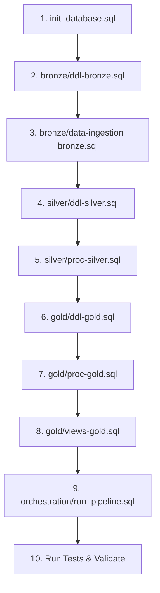

# 🚀 Pipeline Runbook & Operations Guide

This runbook provides step-by-step technical instructions for deploying, orchestrating, testing, and troubleshooting the `DW` data warehouse.

> [!TIP]
> **🔰 Little to no coding experience?**  
> If you are an FM player looking for a simple, non-technical walkthrough with download links and 1-click startup on Windows, Mac, or Linux, start with the **[Zero-Coding Beginner Setup Guide](BEGINNER_SETUP_GUIDE.md)**!

---

## 1. Prerequisites & Environment Setup

### Required Software
* **Database Engine:** [Docker Desktop](https://www.docker.com/products/docker-desktop/) (recommended for Windows / macOS / Linux) OR native [Microsoft SQL Server 2022](https://www.microsoft.com/en-us/sql-server/sql-server-downloads) (2017, 2019, 2022, or Azure SQL Managed Instance).
* **Web App Runtime:** [Node.js](https://nodejs.org/) (v18+ LTS) to run the Next.js interactive scouting engine.
* **Database Management Tools (Optional):** [SQL Server Management Studio (SSMS)](https://aka.ms/ssmsfullsetup) (Windows only), [Azure Data Studio](https://azure.microsoft.com/en-us/products/data-studio/) (cross-platform), or `sqlcmd`.
* **Database Permissions:** User must possess `CREATE DATABASE`, `ALTER ANY SCHEMA`, and `ADMINISTER BULK OPERATIONS` (or `db_owner` / `sysadmin`).
* **Python Runtime (Optional for Visualizations):** [Python 3.9+](https://www.python.org/downloads/) with optional packages `pandas` and `matplotlib` for CLI radar charts and scatter plots.

---

## 2. End-to-End Deployment Sequence

Follow this order when deploying the database schema and procedures from scratch:



### Step 1: Database Initialization
Open and execute [`sql scripts/init_database.sql`](sql%20scripts/init_database.sql):
* Checks if `DW` exists, closes existing connections, and drops/recreates the database.
* Creates the three base schemas: `bronze`, `silver`, and `gold`.

### Step 2: Bronze Layer Setup
1. Execute [`sql scripts/bronze/ddl-bronze.sql`](sql%20scripts/bronze/ddl-bronze.sql) to define raw landing tables.
2. Execute [`sql scripts/bronze/data-ingestion bronze.sql`](sql%20scripts/bronze/data-ingestion%20bronze.sql) to compile `bronze.load_bronze`:
   * `bronze.load_bronze` dynamically ingests any number of outfield player partitions (`interested_out_players1.csv` ... `interested_out_players8.csv`+) or a single `interested_out_players.csv` into `bronze.fmdata_interested_out_players`.
   * Accepts a configurable `@DataPath` parameter (e.g. `EXEC bronze.load_bronze @DataPath = 'D:\FM Data\';`), so file system locations do not need to be hardcoded.

### Step 3: Silver Layer Setup
1. Execute [`sql scripts/silver/ddl-silver.sql`](sql%20scripts/silver/ddl-silver.sql) to create cleansed staging tables.
2. Execute [`sql scripts/silver/proc-silver.sql`](sql%20scripts/silver/proc-silver.sql) to compile `silver.load_silver`.

### Step 4: Gold Layer Setup
1. Execute [`sql scripts/gold/ddl-gold.sql`](sql%20scripts/gold/ddl-gold.sql) to create dimensional tables, facts, league difficulty references, and `audit.etl_pipeline_log`.
2. Execute [`sql scripts/gold/proc-gold.sql`](sql%20scripts/gold/proc-gold.sql) to compile `gold.load_gold` (with `@Season` parameter) and `gold.usp_scout_similar_players`.
3. Execute [`sql scripts/gold/views-gold.sql`](sql%20scripts/gold/views-gold.sql) to compile all analytical marts, positional similarity engines, tactical archetypes, and succession planning views.

### Step 5: Master Orchestration Setup
Execute [`sql scripts/orchestration/run_pipeline.sql`](sql%20scripts/orchestration/run_pipeline.sql) to compile `dbo.usp_run_warehouse_pipeline`.

---

## 3. Running the Pipeline

### 3.1. Linux & macOS Automated Docker Execution (Recommended)
On Linux and macOS (both Apple Silicon M1/M2/M3/M4 and Intel), the repository provides a 1-click execution script that starts or attaches to SQL Server, verifies connectivity, deploys all DDL/procedures, ingests CSV partitions, and runs the test suites:

```bash
# 1. (Optional) Customize environment variables (e.g. set FM_DATA_DIR to your custom FM export directory)
cp .env.example .env

# 2. Run the orchestrator
chmod +x run_pipeline_docker.sh run_webapp.sh
./run_pipeline_docker.sh
```

> [!TIP]
> **Apple Silicon Macs:** The SQL Server container runs with `platform: linux/amd64` using Docker Desktop's native Rosetta 2 emulation. No extra setup is required.

> [!TIP]
> **Customizing Data Directories:** To point to a custom export path outside Steam Proton or adjust Docker volume mounts, see [Section 1.2 of the FM Export Guide](file:///docs/FM_EXPORT_GUIDE.md#12-changing-export--ingestion-directories).

Or spin up SQL Server via Docker Compose and execute through `sqlcmd`:
```bash
docker compose up -d

# Inside container (or from host with mapped port):
docker exec -it sql_server /opt/mssql-tools18/bin/sqlcmd -S localhost -U sa -P 'McMedal@14' -C -d DW \
    -Q "EXEC dbo.usp_run_warehouse_pipeline @Season = '2023/24', @RunTests = 1;"
```

### 3.2. Windows Automated Docker Execution (PowerShell)
On Windows with Docker Desktop installed, execute the automated PowerShell runner directly from the project directory:

```powershell
powershell -ExecutionPolicy Bypass -File .\run_pipeline_docker.ps1
```

To run for a specific season:
```powershell
powershell -ExecutionPolicy Bypass -File .\run_pipeline_docker.ps1 -Season "2024/25"
```

### 3.3. Native SQL Execution (Windows / SSMS / Azure Data Studio without Docker)
To run Bronze ingestion, Silver cleansing, Gold dimensional loading, and integrity sanity checks in a single automated transaction with audit logging on native SQL Server:

```sql
USE DW;
GO

-- Execute pipeline for initial season 2023/24 (auto-detects Linux /data/ vs Windows paths)
EXEC dbo.usp_run_warehouse_pipeline 
    @Season = '2023/24', 
    @RunTests = 1;
```

### 3.4. Ingesting a New Season Going Forward (Multi-Season SCD2)
When transitioning to a new in-game season (e.g. from `2023/24` to `2024/25`):

1. **Export Fresh Data from FM24:** Export your fresh HTML or CSV files from FM24 into your export directory (e.g. `24-25/` subfolder or root export folder).
2. **Execute Ingestion:** Run the 1-click seasonal preparation and ingestion command:

```bash
./prepare_data.sh --season 2024/25
```

This single command automatically:
* **Auto-detects & Normalizes:** Detects the new season's exports (e.g., in a `24-25/` or `2024-25/` subfolder, unzips archives if needed, and normalizes outfield and goalkeeper schemas).
* **Prunes Stale Partitions:** Automatically removes old partition files (e.g., `interested_out_players*.csv`) from both `documents/` on the host and `/data/` inside the container to prevent partition leakage.
* **Synchronizes Container:** Copies the standardized CSVs into `/data/` inside the SQL Server container.
* **Executes Pipeline:** Calls `EXEC dbo.usp_run_warehouse_pipeline @Season = '2024/25', @DataPath = '/data/', @RunTests = 1;`.
* **Maintains SCD Type 2 History:** Automatically expires previous records (`dwh_current_validity = 0`, `dwh_cd_valid_till = GETDATE()`) and activates the new season (`dwh_current_validity = 1`) without deleting past history.

> [!IMPORTANT]
> **Why Not Run `EXEC dbo.usp_run_warehouse_pipeline` Alone in SSMS?**  
> `dbo.usp_run_warehouse_pipeline` runs inside the SQL Server Docker container and reads the CSV files currently located in `/data/` inside the container. Executing `EXEC dbo.usp_run_warehouse_pipeline @Season = '2024/25'` directly in SSMS or Azure Data Studio without running `./prepare_data.sh` will **not** transfer your new export files from your host machine into the container; it will simply re-ingest the previous season's CSV files already inside the container, producing duplicate players with identical stats. Always use `./prepare_data.sh --season <SEASON>` (or run `./prepare_data.sh` before the SQL command) to synchronize your data.

#### Alternative: Manual Two-Step Execution
If you prefer to separate file synchronization from SQL pipeline execution:
1. Synchronize the files to the container:
   ```bash
   ./prepare_data.sh
   ```
2. Then execute the master orchestrator in SSMS, Azure Data Studio, or `sqlcmd`:
   ```sql
   EXEC dbo.usp_run_warehouse_pipeline 
       @Season = '2024/25', 
       @RunTests = 1;
   ```

### 3.5. Midseason & Winter Transfer Ingestion (Intra-Season SCD2)
The warehouse natively supports midseason data exports (e.g. at the January transfer window or during a midseason tactical review) without affecting or distorting subsequent end-of-season loads:

1. **Intra-Season Execution:** Export current form and squad data from FM24 midseason, sync via `./prepare_data.sh`, and run the pipeline specifying the current season:
   ```sql
   EXEC dbo.usp_run_warehouse_pipeline 
       @Season = '2023/24', 
       @RunTests = 1;
   ```
2. **Winter Transfers & Attribute Shifts:**
   * If a player transfers between clubs (e.g., from Midseason FC to Winter Transfer United), the previous dimension and fact records are retired (`dwh_current_validity = 0`, `dwh_cd_valid_till = GETDATE()`).
   * A new active dimension and fact record is generated linking to the player's new club and updated match statistics.
3. **End-of-Season Convergence:**
   * When the end-of-season export is ingested at the conclusion of May, the pipeline retires the midseason snapshot and activates the definitive season totals.
   * Exactly **1 active row** (`dwh_current_validity = 1`) exists per player across `gold.dim_player_info`, `gold.fact_outfield_player_stats`, `gold.fact_gk_stats`, and `gold.fact_players_value`.
4. **Isolated Multi-Season Progression:**
   * Analytical growth views ([`gold.vw_player_growth_tracking`](file:///sql%20scripts/gold/views-gold.sql) and [`gold.vw_gk_growth_tracking`](file:///sql%20scripts/gold/views-gold.sql)) partition historical snapshots by `season` and select the definitive snapshot (`rn_season_latest = 1`).
   * This guarantees that delta comparisons (e.g., season-over-season wage increases or transfer valuation changes) compare true full-season baselines without confusing intra-season midseason snapshots for full separate campaigns.

---

## 4. Monitoring & Pipeline Auditing

Check execution status, duration, and error diagnostics in the audit log:

```sql
SELECT 
    log_id,
    batch_id,
    pipeline_layer,
    step_name,
    status,
    start_time,
    end_time,
    duration_ms,
    error_message
FROM audit.etl_pipeline_log
ORDER BY log_id DESC;
```

---

## 5. Ad-Hoc Player Scouting Procedure

The warehouse provides a dedicated stored procedure, `gold.usp_scout_similar_players`, to scout direct replacements for any player in your database by name or ID:

```sql
-- Find the top 10 closest replacements for veteran striker Edin Džeko:
EXEC gold.usp_scout_similar_players 
    @TargetPlayerName = 'Edin Džeko', 
    @TopN = 10;

-- Find the top 5 closest replacements for midfielder Rolando Mandragora:
EXEC gold.usp_scout_similar_players 
    @TargetPlayerName = 'Rolando Mandragora', 
    @TopN = 5;

-- Find replacements by exact Player Key:
EXEC gold.usp_scout_similar_players 
    @TargetPlayerKey = 104, 
    @TopN = 10;
```

The output returns:
* Rank (#1 to #N)
* Player Name, Age, Club, League, Minutes
* Weekly Wage (£k) and Transfer Valuation (£M)
* Tactical similarity distance (Euclidean metric)
* Tactical profile match percentage ($0 - 100\%$)

---

## 6. Automated Testing Suites

All test scripts in [`sql scripts/tests/`](sql%20scripts/tests/) execute within transactions wrapped in `BEGIN TRANSACTION ... ROLLBACK TRANSACTION`. Running tests will **never pollute or alter production data**.

### 6.1. Data Integrity & Boundary Tests
Execute [`sql scripts/tests/test_data_integrity.sql`](sql%20scripts/tests/test_data_integrity.sql):
* **Active Record Uniqueness:** Verifies zero duplicate active player/team combinations.
* **Referential Integrity:** Asserts that fact tables have zero orphaned foreign keys pointing to nonexistent dimension keys.
* **Domain Boundaries:** Asserts percentages stay in $[0.00, 1.00]$, minutes $\ge 0$, and valid ages $[14, 45]$.
* **SCD Type 2 Timeline Consistency:** Asserts `dwh_cd_valid_till >= dwh_create_date`.

### 6.2. Similarity Engine Verification
Execute [`sql scripts/tests/test_vw_similar_positions.sql`](sql%20scripts/tests/test_vw_similar_positions.sql):
* Verifies starting incumbent has rank 0 and similarity distance $0.00$.
* Confirms squad players (`is_own_squad = 1`) are excluded from target pool rankings.
* Asserts minimum minute thresholds are respected ($Mins \ge 900$).
* Confirms zero `NULL` Euclidean distance values exist across all 8 positional views.

### 6.3. Squad Report Calculations
Execute [`sql scripts/tests/test_vw_squad_central_defender_reports.sql`](sql%20scripts/tests/test_vw_squad_central_defender_reports.sql):
* Validates derived calculation formulas for squad performance reports.

### 6.4. Midseason & Intra-Season SCD2 Isolation Tests
Execute [`sql scripts/tests/test_midseason_ingestion.sql`](sql%20scripts/tests/test_midseason_ingestion.sql):
* **Intra-Season Ingestion:** Asserts active records are properly created during January midseason exports.
* **Winter Transfers:** Confirms club transfers resolve to the active team upon end-of-season load without orphan keys.
* **Active Record Convergence:** Validates that end-of-season ingestion retires midseason snapshots and leaves exactly 1 active record across `gold.dim_player_info` and all three fact tables (`fact_outfield_player_stats`, `fact_gk_stats`, `fact_players_value`).
* **Multi-Season Growth Continuity:** Asserts that [`gold.vw_player_growth_tracking`](file:///sql%20scripts/gold/views-gold.sql) accurately calculates season-over-season deltas across distinct campaigns without confusing intra-season intermediate snapshots for full independent seasons.

---

## 7. Troubleshooting & FAQs

### Issue: `Cannot bulk load because the file could not be opened` (Operating System Error 3)
* **Cause:** The absolute path specified in `bronze.load_bronze` does not exist on the machine hosting the SQL Server instance.
* **Fix:** Update the file paths in `sql scripts/bronze/data-ingestion bronze.sql` to match your local system. In SQL Server on Linux, use Linux paths (e.g. `/var/opt/mssql/data/...`); on Windows, use Windows paths (e.g. `C:\Users\...\team_players.csv`).

### Issue: `Cannot bulk load because the file is in use by another process`
* **Cause:** The CSV file is open in Microsoft Excel or another desktop application with an exclusive file lock.
* **Fix:** Close Excel or file viewers before re-running the ingestion pipeline.

### Issue: `UTF-8 characters or accented player names appear corrupted (e.g. 'D?eko')`
* **Cause:** SQL Server default collation does not interpret raw UTF-8 text correctly without codepage specification.
* **Fix:** Ensure `CODEPAGE = '65001'` is specified in the `BULK INSERT` `WITH` clause, and that destination name columns use `NVARCHAR` or `VARCHAR` with UTF-8 collations (`LATIN1_GENERAL_100_CI_AS_SC_UTF8`).

### Issue: `CREATE VIEW must be the only statement in the batch`
* **Cause:** SQL Server requires `CREATE OR ALTER VIEW` to be the first statement in a batch.
* **Fix:** Ensure every view in `views-gold.sql` is delimited with `GO` statements before and after the view definition.

---

## 8. Starting the Web Application (Interactive Analytics & Screener)

The data warehouse includes an interactive full-stack Next.js web application modeled after FBref and Opta, featuring a TradingView-style quantitative player and goalkeeper screener.

### 8.1. 1-Click Startup Script (Recommended)
From the root of the project, execute:
```bash
./run_webapp.sh
```

The startup script handles the complete lifecycle:
1. **Container Check:** Inspects Docker to see if `sql_server` is running. If not, it runs `docker compose up -d sql-server` and waits for database readiness.
2. **Node Environment:** Validates that `node` and `npm` are in PATH (including `~/.local/bin`).
3. **Dependencies:** Checks `webapp/node_modules/` and runs `npm install` automatically on first launch.
4. **Environment Secrets:** Generates `webapp/.env.local` with default Docker SQL Server credentials if it does not already exist.
5. **Boots Server:** Launches Next.js at [http://localhost:3000](http://localhost:3000).

### 8.2. Manual Startup
If you prefer running commands manually:
```bash
# 1. Ensure SQL Server Docker container is running:
docker compose up -d sql-server

# 2. Navigate to the webapp directory:
cd webapp

# 3. Install packages (first run only):
npm install

# 4. Start the Next.js development server:
npm run dev
```

### 8.3. Database Connection Configuration
Credentials are read by `lib/db.ts` from `webapp/.env.local`:
```ini
MSSQL_USER=sa
MSSQL_PASSWORD=McMedal@14
MSSQL_SERVER=localhost
MSSQL_PORT=1433
MSSQL_DATABASE=DW
```

### 8.4. Web Application Troubleshooting
* **Issue: `ConnectionError: Failed to connect to localhost:1433`**
  * *Fix:* Check if the container is running with `docker ps`. If stopped, run `docker compose up -d sql-server`.
* **Issue: `Port 3000 is already in use`**
  * *Fix:* Another process is listening on port 3000. Terminate it with `fuser -k 3000/tcp` or start Next.js on an alternate port with `npm run dev -- -p 3001`.
* **Issue: `node: command not found`**
  * *Fix:* Ensure Node.js (v18+) is installed and in your user PATH (e.g. `export PATH="$HOME/.local/bin:$PATH"`).

