# 📚 DW Documentation Hub

Welcome to the comprehensive technical and operational documentation for the **Football Manager Data Warehouse & Moneyball Analytics Engine** (`DW`).

This documentation suite covers every aspect of the data platform, from raw game export procedures and Medallion architecture ingestion pipelines to dimensional modeling, Euclidean similarity mathematics, automated testing, and Python visualization.

---

## 🧭 Documentation Navigator

| Guide | Description | Target Audience |
| :--- | :--- | :--- |
| **[🎯 Scouting Playbook](file:///home/mcmedal/Documents/Github/football-manager-warehouse-project/docs/SCOUTING_PLAYBOOK.md)** | Step-by-step recruitment workflows, query recipes for 5 common transfer scenarios, and decision matrices. | Football Managers, Scouts |
| **[Architecture & Design](file:///home/mcmedal/Documents/Github/football-manager-warehouse-project/docs/ARCHITECTURE.md)** | Medallion architecture (Bronze/Silver/Gold), Star Schema design, SCD Type 2 time-travel, audit logging, and design decisions. | Data Engineers, Database Architects |
| **[Data Dictionary](file:///home/mcmedal/Documents/Github/football-manager-warehouse-project/docs/DATA_DICTIONARY.md)** | Full schema catalog covering all tables, views, columns, data types, business definitions, keys, and nullability constraints. | Analytics Engineers, SQL Developers |
| **[Metrics & Similarity Mathematics](file:///home/mcmedal/Documents/Github/football-manager-warehouse-project/docs/METRICS_AND_SIMILARITY.md)** | Deep mathematical formulation of scale-weighted Euclidean distance, finishing delta shrinkage, tactical archetypes, and per-90 metrics. | Football Analysts, Scout Researchers |
| **[Pipeline Runbook & Operations](file:///home/mcmedal/Documents/Github/football-manager-warehouse-project/docs/PIPELINE_RUNBOOK.md)** | Step-by-step setup, database creation, execution orchestration, ad-hoc scouting procedures, automated testing, and troubleshooting. | Database Administrators, Users |
| **[FM24 Data Export Guide](file:///home/mcmedal/Documents/Github/football-manager-warehouse-project/docs/FM_EXPORT_GUIDE.md)** | Practical walkthrough on setting up custom views in FM24, exporting CSV/HTML data, file placements, and configuring for any club/save. | Football Manager Players |
| **[Python Analytics & Dashboard](file:///home/mcmedal/Documents/Github/football-manager-warehouse-project/docs/PYTHON_ANALYTICS.md)** | CLI documentation for `scouting_dashboard.py`, generating radar charts, Moneyball scatter plots, and CSV recruitment shortlists. | Data Scientists, End Users |

---

## ⚡ Quick Architecture Overview

```mermaid
flowchart LR
    subgraph Raw ["1. FM24 Raw Data"]
        E1[Squad & GK Exports]
        E2[Scouting Pool Exports]
        E3[Staff Exports]
    end

    subgraph Bronze ["2. Bronze Layer"]
        B1[(Raw Landing Tables)]
        BP[bronze.load_bronze]
    end

    subgraph Silver ["3. Silver Layer"]
        S1[(Cleaned & Typed Tables)]
        SP[silver.load_silver]
    end

    subgraph Gold ["4. Gold Layer"]
        G1[(Star Schema: Facts & Dims)]
        G2[SCD Type 2 Historization]
        GP[gold.load_gold]
    end

    subgraph Analytics ["5. Analytical Marts"]
        M1[8x Positional Similarity Engines]
        M2[Tactical Archetypes]
        M3[Bargain Watch & Succession Plan]
        M4[Multi-Season Growth Tracking]
    end

    subgraph Consumer ["6. Consumption"]
        P1[SQL Queries / SSMS]
        P2[Python Visual Dashboard]
        P3[Shortlist CSV Exports]
    end

    Raw --> BP --> Bronze
    Bronze --> SP --> Silver
    Silver --> GP --> Gold
    Gold --> Analytics
    Analytics --> Consumer
```

---

## 📌 Key Architectural Highlights

1. **100% Club & League Portability:**
   * Uses an `is_own_squad` flag instead of hardcoded club names (e.g. `'Fiorentina'`).
   * Dynamic league difficulty normalization coefficients in `gold.dim_league`.
   * Drop-in ready for any Football Manager 2024 save.
2. **Slowly Changing Dimensions (SCD Type 2):**
   * Preserves historical snapshots across multiple seasons (`2023/24`, `2024/25`, etc.) with `dwh_create_date`, `dwh_cd_valid_till`, and `dwh_current_validity`.
   * Enables longitudinal career progression and growth analysis (`gold.vw_player_growth_tracking`).
3. **Robust Positional Similarity Engines:**
   * Scale-weighted Euclidean distance with position-specific metric weight vectors.
   * Null-safe design using tactical baseline imputation to avoid SQL Server `NULL` arithmetic propagation.
4. **Automated Testing & Auditability:**
   * Transactional test suites (`ROLLBACK` guaranteed) verifying referential integrity, domain boundaries, and similarity rankings.
   * Centralized pipeline execution audit trail in `audit.etl_pipeline_log`.
