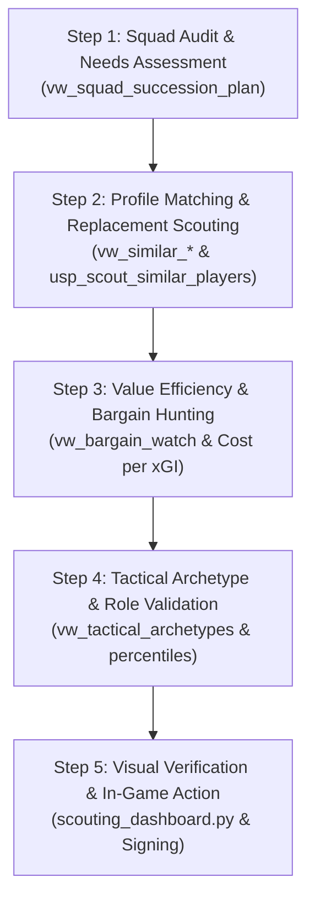

# 🎯 The Moneyball Scouting Playbook: How to Scout Players with DW

Welcome to **The Complete Scouting Playbook**. This guide demonstrates how to use the entire `DW` platform to identify, evaluate, and recruit football players in Football Manager 2024.

Whether you are replacing an injured talisman, planning a multi-year squad overhaul, or operating on a shoestring budget, this playbook translates raw SQL views and Python visualizations into actionable recruitment decisions.

---

## 🧭 The 5-Step Moneyball Recruitment Workflow



---

## 🔍 How to Interpret Key Scouting Metrics

Before querying, understand the baseline thresholds used in elite football analytics:

| Metric | Elite Threshold | Good / Starter | Warning Sign | Tactical Meaning |
| :--- | :--- | :--- | :--- | :--- |
| **Similarity Distance** | $< 1.00$ | $1.00 - 1.80$ | $> 2.50$ | Statistical clone vs. different player profile. |
| **Profile Match %** | $\ge 85\%$ | $70\% - 84\%$ | $< 60\%$ | Overall compatibility with your starter's output. |
| **NPxG / 90** | $\ge 0.40$ | $0.25 - 0.39$ | $< 0.15$ | Goal threat from open play without penalty inflation. |
| **xA / 90** | $\ge 0.22$ | $0.14 - 0.21$ | $< 0.08$ | Expected assists delivered to teammates per 90. |
| **NPxG + xA / 90** | $\ge 0.55$ | $0.35 - 0.54$ | $< 0.20$ | Combined direct goal involvement danger. |
| **Chance Quality** ($xA/\text{OP-KP}$) | $\ge 0.20$ | $0.12 - 0.19$ | $< 0.08$ | Creates clear tap-ins vs. speculative low-xG shots. |
| **Prog. Passes / 90** | $\ge 5.50$ | $3.50 - 5.49$ | $< 2.00$ | Line-breaking vertical passing to advance attacks. |
| **Aerial Duels Won / 90** | $\ge 4.00$ | $2.50 - 3.99$ | $< 1.50$ | First-ball dominance in aerial contests. |
| **Heading Accuracy** | $\ge 65\%$ | $55\% - 64\%$ | $< 45\%$ | Duel win rate in the air. |
| **Cost per xGI (£k)** | $< 3,000$ | $3,000 - 8,000$ | $> 15,000$ | Total fee + wage cost per expected goal involvement. |

---

## 🛠️ Practical Scouting Scenarios

---

### Scenario 1: "Our Star Player is Being Sold" (Like-for-Like Replacement)

**Situation:** A wealthy club bids for your starting forward or central defender. You need an immediate, system-ready statistical clone who replicates their output.

#### Step 1A: Query the Dedicated Positional Engine
Every starting position has an automated similarity view comparing scouted targets against your starter (`rank = 0`):

```sql
-- Find the top 5 closest statistical clones to your starting Striker
SELECT TOP 5
    target_player_name,
    age,
    club_name,
    league,
    transfer_value_m,
    wage_per_week_k,
    similarity_distance,
    profile_match_pct,
    target_npxg_per90,
    target_conversion_rate,
    target_aerial_won_per90
FROM gold.vw_similar_strikers
WHERE transfer_value_m <= 15.0  -- Adjust for your transfer budget
  AND wage_per_week_k <= 40.0   -- Adjust for your wage ceiling
ORDER BY similarity_distance ASC;
```

#### Step 1B: Use the Ad-Hoc Stored Procedure for ANY Player
If you want to replace a specific rotation player or model a target after an opposition superstar:

```sql
-- Find the closest 5 alternatives to Edin Džeko:
EXEC gold.usp_scout_similar_players 
    @TargetPlayerName = 'Edin Džeko', 
    @TopN = 5;
```

#### Step 1C: Visual Radar Validation in Python
Generate a 6-axis visual radar chart comparing the target against your departing starter:

```bash
python "python scripts/scouting_dashboard.py" \
    --mode radar \
    --target "Lucas Beltrán" \
    --starter "M'Bala Nzola" \
    --position "Striker"
```
* **What to look for:** Look for whether the target's radar polygon overlaps or expands beyond the starter's polygon in critical roles (e.g. Shooting Danger, Aerials, Progression).

---

### Scenario 2: "Aging Veterans ($\ge 30$) Need Long-Term Successors"

**Situation:** Your best players are 31 or 32. Their physical attributes will soon decline. You need U23 wonderkids who match their profile to develop as understudies.

#### The Query:
```sql
SELECT 
    starter_name,
    starter_age,
    position,
    u23_rank,
    successor_name,
    successor_age,
    successor_club,
    successor_transfer_value_m,
    successor_wage_k,
    similarity_distance
FROM gold.vw_squad_succession_plan
ORDER BY starter_name, u23_rank;
```

#### How to Act in FM24:
1. Identify the top-ranked U23 successor (`u23_rank = 1`).
2. Add them to your FM24 **Shortlist** with a 1-year watch.
3. If their `similarity_distance < 1.50` and fee is reasonable, sign them as a "Squad Player" or "Impact Sub" to groom them for the starting role next season.

---

### Scenario 3: "Hunting for Undervalued Moneyball Bargains"

**Situation:** You are managing on a tight budget or want to extract maximum efficiency per euro spent. You want players with elite output who play for smaller clubs or obscure leagues.

#### The Query:
```sql
SELECT TOP 10
    player_name,
    age,
    club_name,
    league,
    position,
    npxg_plus_xa_per90,
    transfer_value_m,
    wage_per_week_k,
    cost_per_xgi_k
FROM gold.vw_bargain_watch
WHERE age BETWEEN 19 AND 25
ORDER BY cost_per_xgi_k ASC;
```

#### Analytical Breakdown:
* **`cost_per_xgi_k`**: Total financial outlay (transfer fee in £k + annual wages in £k) divided by expected goal contributions ($NPxG + xA$).
* A player with a score under `£2,500k / xGI` generates goals at **one-tenth the cost** of a Premier League regular.

---

### Scenario 4: "Recruiting for a Specific Tactical Archetype"

**Situation:** You want to play a possession-dominant Gegenpress. You specifically need a **Ball-Playing Defender (BPD)** and a **Deep-Lying Playmaker (DLP)**.

#### Step 4A: Filter by Tactical Archetype
```sql
-- Find scouted Ball-Playing Defenders who are under 26:
SELECT 
    player_name,
    age,
    club_name,
    league,
    tactical_archetype,
    progressive_passes_per90,
    prog_rate_per_pass,
    transfer_value_m,
    wage_per_week_k
FROM gold.vw_tactical_archetypes
WHERE tactical_archetype = 'Ball-Playing Defender'
  AND is_own_squad = 0
  AND age <= 26
ORDER BY progressive_passes_per90 DESC;
```

#### Step 4B: Archetype Catalog for FM Tactical Systems

| If Your Tactic Requires: | Query `tactical_archetype` In `vw_tactical_archetypes`: | Key Metrics to Prioritize |
| :--- | :--- | :--- |
| **Buildup Centerback** | `'Ball-Playing Defender'` | `prog_rate_per_pass >= 5.0`, `pass_accuracy >= 0.85` |
| **Aggressive Stopper** | `'Stopper / No-Nonsense Defender'` | `aerial_duels_won_per90 >= 3.5`, `heading_accuracy >= 0.65` |
| **Attacking Flank Width** | `'Attacking Wingback'` | `completed_crosses_per90 >= 1.0`, `sprints_per90 >= 12.0` |
| **Inverted Flank Builder**| `'Inverted Fullback'` | `prog_rate_per_pass >= 6.0`, `turnover_rate <= 0.18` |
| **Tempo Controller** | `'Deep-Lying Playmaker'` | `passes_per90 >= 55.0`, `prog_passes_per90 >= 4.5` |
| **Pressing Engine** | `'Ball-Winning Midfielder'` | `defensive_actions_per90 >= 5.5`, `pressure_efficiency >= 0.25` |
| **Dual-Phase Midfielder** | `'Box-to-Box Midfielder'` | `distance_km >= 13.0`, `sprints >= 10.0`, `NPxG+xA >= 0.15` |
| **Inverted Goal Threat** | `'Inside Forward'` | `goal_threat_share >= 0.55`, `shots_per90 >= 1.8` |
| **Target Man** | `'Target Forward'` | `aerial_duels_won_per90 >= 4.0`, `heading_accuracy >= 0.55` |
| **Elite Sweeper Keeper** | `'Sweeper Keeper'` (in GK view) | `sweeper_index >= 1.5`, `shot_stopping_delta >= +0.05` |

---

### Scenario 5: "Checking Player Growth & Trajectory" (Multi-Season Verification)

**Situation:** A 22-year-old winger had an amazing year in Belgium. Is this sustainable growth or a temporary spike?

#### The Query:
```sql
SELECT 
    player_name,
    age,
    club_name,
    prior_season,
    current_season,
    delta_npxg_plus_xa,
    delta_prog_passes,
    delta_def_actions,
    delta_transfer_value_m,
    development_trajectory
FROM gold.vw_player_growth_tracking
WHERE player_name LIKE '%Your Target Name%'
ORDER BY current_season DESC;
```

#### Trajectory Classifications:
* **`Rapid Ascendant`**: $\Delta(NPxG + xA) \ge +0.15$ and positive progression delta. **Buy immediately.**
* **`Steady Developer`**: Modest positive improvements across all departments. Reliable investment.
* **`Regression / Stagnant`**: Negative deltas season-over-season. Warning sign: do not overpay.

---

## 💻 Full Python Recruitment Command Line Cheat Sheet

Run these commands from your terminal:

```bash
# 1. Export the top 50 ranked Moneyball targets across all positions:
python "python scripts/scouting_dashboard.py" --mode export --top 50

# 2. Generate a visual comparison radar chart against your incumbent striker:
python "python scripts/scouting_dashboard.py" \
    --mode radar \
    --target "Lucas Beltrán" \
    --starter "M'Bala Nzola" \
    --position "Striker"

# 3. Generate a Moneyball Valuation vs. Output scatter plot for Wingers:
python "python scripts/scouting_dashboard.py" \
    --mode scatter \
    --position "Winger"
```

---

## 🏆 Summary Checklist for Transfer Windows

Before clicking "Confirm Transfer" in Football Manager 24, confirm:
- [ ] **Similarity Distance:** Is the player within $D < 1.80$ of your squad profile?
- [ ] **Finishing Check:** If buying a striker, check `finishing_delta_shrunk`. Do not pay a premium if their output is driven purely by an unsustainable finishing streak over $< 1,000$ minutes.
- [ ] **Creation Quality:** If buying an attacking midfielder, ensure $xA / \text{OP-KP} \ge 0.15$.
- [ ] **Turnover Rate:** If buying a deep playmaker, confirm `turnover_rate \le 0.15`.
- [ ] **Financial Sanity:** Check `cost_per_xgi_k`. Are you spending efficiently relative to expected goal production?
